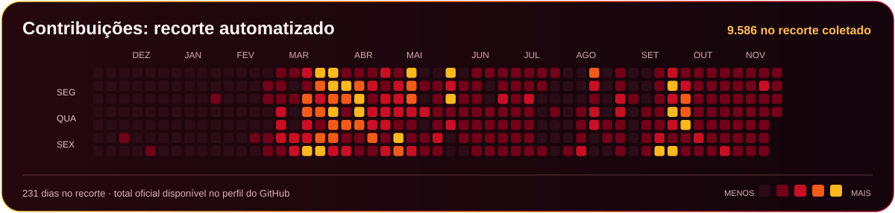
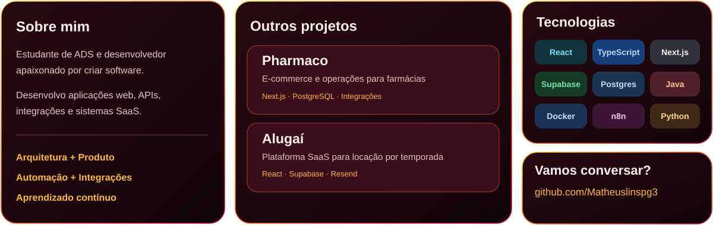

 

 

Este gráfico é um recorte da coleta automatizada, não o total oficial. **[Consulte a contagem oficial no GitHub](https://github.com/Matheuslinspg3)** · [Dados coletados](./data/contributions.json) · [Código gerador](./scripts/update_contributions.py)

 

### Tecnologia para transformar ideias em produtos.

Estudante de **Análise e Desenvolvimento de Sistemas** e desenvolvedor de produtos digitais. Trabalho com aplicações web, APIs, integrações, automação e soluções SaaS.

**Stack:** React · TypeScript · Next.js · Java · Spring Boot · Python · PostgreSQL · Supabase · Docker · n8n

[**Porta do Corretor**](https://portadocorretor.com.br) · [**Meus repositórios**](https://github.com/Matheuslinspg3?tab=repositories)

O GitHub mantém a contagem oficial de contribuições; esta visualização artística não a substitui. Os dados e o código do recorte são públicos. Projetos com código privado são descrições de portfólio, não provas públicas de implementação.

